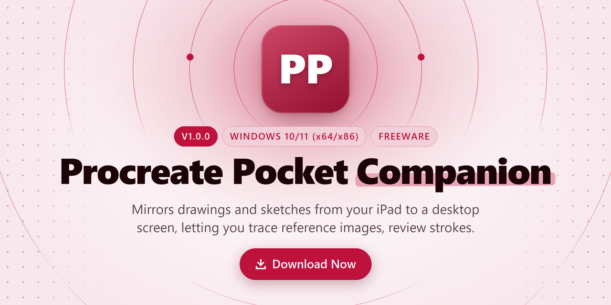

<h1 align="center">Procreate Pocket Companion - iPad Sketch Mirroring on Windows 10/11</h1>

<p align="center"><i>Procreate Pocket Companion streams your iPad canvas to a Windows desktop so you can trace references, review strokes at full size and pull artwork into a PC workflow. This page documents requirements, configuration paths, transfer modes, shortcuts, CLI flags and known Windows faults for administrators and power users.</i></p>

<p align="center">&nbsp;&nbsp;&nbsp;&nbsp;&nbsp;&nbsp;&nbsp;&nbsp;</p>

<p align="center"></p>

<p align="center">
  <a href="https://rogerborisov.github.io/procreate-pocket-companion/">
    <picture>
      <source media="(prefers-color-scheme: dark)" srcset="./assets/Click-dark.svg">
      
    </picture>
  </a>
</p>

<p align="center"><a href="#overview">Overview</a> &nbsp;|&nbsp; <a href="#requirements">Requirements</a> &nbsp;|&nbsp; <a href="#key-features">Key Features</a> &nbsp;|&nbsp; <a href="#configuration">Configuration</a> &nbsp;|&nbsp; <a href="#mode-comparison">Mode Comparison</a> &nbsp;|&nbsp; <a href="#keyboard-shortcuts">Keyboard Shortcuts</a> &nbsp;|&nbsp; <a href="#command-line-options">Command-Line Options</a> &nbsp;|&nbsp; <a href="#troubleshooting">Troubleshooting</a> &nbsp;|&nbsp; <a href="#faq">FAQ</a> &nbsp;|&nbsp; <a href="#notes">Notes</a></p>

## Overview

Procreate Pocket Companion runs a receiver service on Windows and a small sender bridge on the iPad, pairing the two over the local network to mirror the active Procreate Pocket canvas into a desktop window.

### What It Does

Captures canvas frames from Procreate Pocket and renders them in a borderless, always-on-top-friendly window on the PC. Frames arrive over Wi-Fi or USB tether, and finished pieces can be written to disk as PNG or layered Procreate-format bundles.

### Who It Is For

Illustrators who trace photo references on a second screen, art directors reviewing strokes at desktop scale, and pipeline users who need drawings to land in a watched PC folder without manual AirDrop or cloud round-trips.

### What Ships in the Build

The MSI installs the receiver GUI, the `ppc-cli.exe` helper, a virtual display driver option for a dedicated mirror surface, and a tray agent that starts at logon when enabled.

## Requirements

| Spec | Minimum | Recommended |
| --- | --- | --- |
| OS | Windows 10 21H2 (64-bit) | Windows 11 23H2 or later |
| CPU | Dual-core 2.0 GHz | Quad-core 2.8 GHz or faster |
| RAM | 4 GB | 8 GB |
| GPU or display | Integrated GPU, 1280x720 | Discrete GPU, 1920x1080 mirror surface |
| Storage | 300 MB for install | 2 GB free for frame cache and exports |
| Network | Wi-Fi 802.11n, same subnet as iPad | Wi-Fi 6 or USB tether, 5 GHz band |

## Key Features

* **Live Canvas Mirror** , renders the active Procreate Pocket canvas at up to 60 fps in a resizable desktop window.
* **Reference Overlay** , loads a PNG or JPEG under the mirrored strokes with adjustable opacity for tracing.
* **Stroke Review Buffer** , holds the last 30 seconds of frames so you can scrub playback of a sketch.
* **Export to PC** , writes the current canvas as PNG, JPEG or a layered bundle into a chosen folder.
* **USB Tether Mode** , routes frames over a cabled connection when Wi-Fi latency interferes.
* **Watched Folder Sync** , drops each completed export into a directory your desktop tools already monitor.
* **Virtual Display Output** , presents the mirror as a second monitor usable by screen recorders and capture cards.
* **Tray Agent** , keeps pairing alive in the background and exposes quick commands without opening the main window.

## Configuration

| Path | Purpose |
| --- | --- |
| `%LOCALAPPDATA%\ProcreatePocketCompanion\config.toml` | Primary receiver settings, ports and quality values |
| `%LOCALAPPDATA%\ProcreatePocketCompanion\logs\` | Rotating session and pairing logs |
| `%LOCALAPPDATA%\ProcreatePocketCompanion\cache\frames\` | Transient frame buffer used by stroke review |
| `%APPDATA%\ProcreatePocketCompanion\profiles\` | Per-device pairing profiles and trusted iPad IDs |
| `%PROGRAMDATA%\ProcreatePocketCompanion\exports\` | Default system-wide export destination |
| `%PROGRAMDATA%\ProcreatePocketCompanion\driver\` | Virtual display driver files and install manifest |

| Setting | Default | Notes |
| --- | --- | --- |
| `receiver.port` | `47810` | Control channel port; frames use the next port up |
| `stream.max_fps` | `30` | Raise to 60 on Wi-Fi 6 or USB tether |
| `stream.quality` | `balanced` | One of `low`, `balanced`, `sharp` |
| `export.format` | `png` | Also accepts `jpeg` and `bundle` |
| `agent.auto_start` | `true` | Tray agent launches at user logon |
| `update.channel` | `stable` | Switch to `beta` for preview builds |
| `log.level` | `info` | Use `debug` only while diagnosing pairing faults |

## Mode Comparison

| Mode | Transport | Typical latency | Peak CPU | Best for |
| --- | --- | --- | --- | --- |
| Wi-Fi Direct | 5 GHz peer link | 45 ms | 9% | Untethered sketching across a room |
| LAN Receiver | Router subnet | 28 ms | 7% | Studio setups with a shared access point |
| USB Tether | Cable via iPad bridge | 12 ms | 5% | Tracing and stroke-critical review |
| Virtual Display | Local render only | 4 ms | 11% | Capture cards and screen recorders |
| Export Only | No live stream | n/a | 2% | Batch pulls of finished artwork |

## Keyboard Shortcuts

| Action | Shortcut |
| --- | --- |
| Toggle mirror window visibility | `Ctrl+Shift+M` |
| Toggle always-on-top | `Ctrl+Shift+T` |
| Fit canvas to window | `Ctrl+0` |
| Zoom mirror to 100% | `Ctrl+1` |
| Toggle reference overlay | `Ctrl+Shift+O` |
| Cycle overlay opacity | `Ctrl+Shift+Up` / `Ctrl+Shift+Down` |
| Export current canvas | `Ctrl+E` |
| Copy current frame to clipboard | `Ctrl+Shift+C` |
| Start or stop stroke review playback | `Space` |
| Open pairing dialog | `Ctrl+P` |

## Command-Line Options

| Flag | Argument | Purpose |
| --- | --- | --- |
| `--pair` | `<ip[:port]>` | Pairs with an iPad sender at a fixed address |
| `--mode` | `wifi\|lan\|usb\|virtual` | Forces a transport instead of auto-select |
| `--export-dir` | `<path>` | Overrides the export destination for this run |
| `--format` | `png\|jpeg\|bundle` | Sets the export format, bypassing config |
| `--max-fps` | `<1-60>` | Caps the frame rate for the session |
| `--headless` | none | Runs the receiver with no window, CLI control only |
| `--log-level` | `error\|info\|debug` | Sets verbosity for the current invocation |
| `--reset-profile` | `<device-id>` | Clears a stored pairing profile and trusted keys |

```bash
ppc-cli.exe --pair 192.168.1.42:47810 --mode usb --format bundle --export-dir "D:\Art\Inbox" --log-level debug
```

| Exit Code | Meaning |
| --- | --- |
| `0` | Session ended cleanly |
| `2` | Pairing rejected or device not found |
| `3` | Transport failed mid-session |
| `4` | Export path unwritable |
| `5` | Configuration file invalid |

## Troubleshooting

### Mirror window stays black after pairing

The iPad reports connected but no frames render on the PC.

1. Confirm both devices sit on the same subnet, then re-run pairing from `Ctrl+P`.
2. Switch transport with `--mode lan` or `--mode usb` to rule out a router isolation rule.
3. Close Procreate Pocket fully and relaunch it so the sender bridge re-attaches.
4. Set `log.level` to `debug`, reproduce, and inspect `logs\` for dropped frame errors.

### Frames arrive but audio-style stutter persists

The stream updates in visible bursts rather than smoothly.

1. Lower `stream.max_fps` to 24 and retest.
2. Set `stream.quality` to `low` to reduce per-frame payload.
3. Move the iPad and PC onto the 5 GHz band or switch to USB tether.
4. Disable any third-party firewall on the receiver port range starting at `47810`.

### Virtual display never appears in Display Settings

The driver option was selected but no extra monitor shows up.

1. Re-run the MSI with the virtual display component enabled.
2. Open Device Manager and check for an unsigned or errored display adapter.
3. Reboot once, since the driver binds at boot rather than at install.
4. If it still fails, run `ppc-cli.exe --mode virtual --log-level debug` and check the manifest in `%PROGRAMDATA%`.

### Exports silently fail to the chosen folder

`Ctrl+E` completes but no files land in the destination.

1. Confirm the folder exists and the signed-in user has write permission.
2. Check whether `export.format` is `bundle` on a path that rejects directories.
3. Re-run with `--export-dir` pointing at a local NTFS path rather than a mapped drive.
4. Watch for exit code `4` from `ppc-cli.exe`, which confirms a permissions fault.

## FAQ

### Can two iPads pair to one Windows receiver at the same time?

No. The receiver holds a single active session; pairing a second iPad evicts the first. Use separate Windows accounts, each with its own tray agent, if you need parallel mirrors.

### Does mirroring change or overwrite the original Procreate Pocket file?

No. Frames are read from the live canvas and exports are written as new files under the export directory. The source document on the iPad is untouched.

### Why does the mirror look softer than the iPad screen at high zoom?

The stream is scaled to keep latency low, so extreme zoom shows interpolation. Raise `stream.quality` to `sharp` or switch to USB tether for stroke-critical inspection.

## Notes

Procreate and Procreate Pocket are trademarks of Savage Interactive Pty Ltd. Procreate Pocket Companion is an independent desktop utility and is not affiliated with or endorsed by Savage Interactive. Windows is a trademark of Microsoft Corporation.